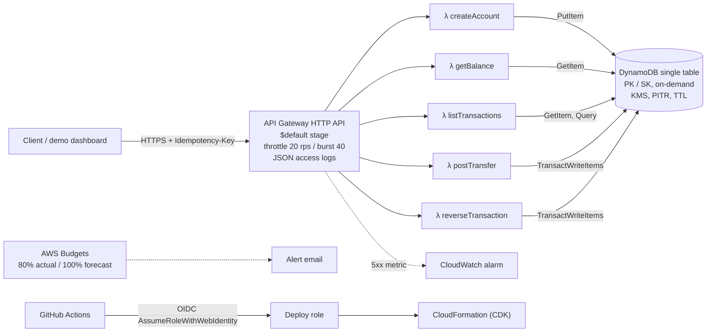
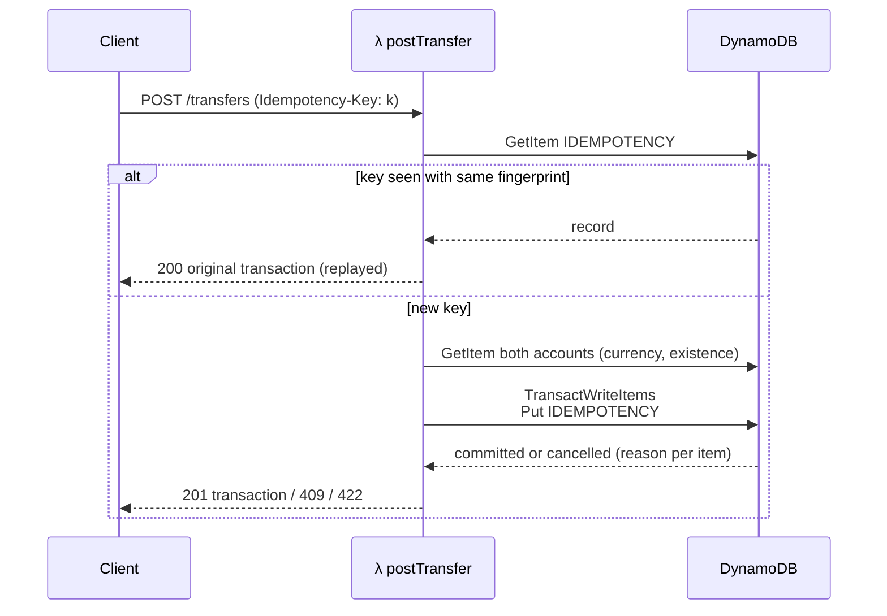

# ledger-api-cdk

A small, production-shaped **double-entry ledger API** on AWS serverless, defined end to end
in **TypeScript with AWS CDK v2**.

`API Gateway (HTTP API)` → `Lambda (Node.js, esbuild-bundled)` → `DynamoDB (single table)`

[](.github/workflows/ci.yml)


> **Security note.** Deployed stacks require a JWT authorizer (`-c jwtIssuer=… -c jwtAudience=…`);
> `cdk synth`/`deploy` refuses to build an unauthenticated API unless you pass
> `-c allowUnauthenticated=true`. **Never deploy that unauthenticated demo mode publicly:** anyone
> who finds the URL could create accounts and post transfers. Stage throttling limits cost, not
> abuse, and AWS WAF cannot be attached to API Gateway HTTP APIs. For a portfolio demo, run the
> design-system dashboard against its built-in mock data instead.

## What it proves

| Concern | How it shows up here |
| --- | --- |
| **Money correctness** | Integer minor units only (no floats), overflow-checked arithmetic, every transaction's entries sum to zero, customer accounts can never go negative. |
| **Atomicity** | Each posting is one DynamoDB `TransactWriteItems` call: idempotency record, transaction, both balance updates (with conditional guards), statement rows and the reversal marker item all land together or not at all. |
| **Idempotency** | `Idempotency-Key` header is required on writes. Same key + same body replays the original result (`200`, `idempotent-replayed: true`); same key + different body is a `409`. Keys are scoped per caller and honored for 7 days; see [Idempotency](#idempotency). |
| **Reversals** | A reversal posts the mirror-image entries, links to the original, and can happen exactly once (an insert-only `REVERSAL` marker item; the original transaction is never mutated). |
| **Auth and ownership** | API Gateway JWT authorizer (Cognito or any OIDC issuer) on every route. Accounts belong to the caller's JWT `sub`: other callers get `404` on reads, debits and reversals; anyone can be paid by account id. |
| **Testing depth** | Domain unit tests, handler tests, DynamoDB adapter tests (mocked SDK), **property-based tests** (fast-check) that run random sequences of transfers, reversals and replays and check the books still balance, plus **CDK assertion tests** for the infrastructure. |
| **Least privilege** | One Lambda and one hand-written IAM role per route. Read routes get `GetItem`/`Query` only, and every statement is pinned to the key prefixes the route touches with `dynamodb:LeadingKeys` (for example `UpdateItem` only on `ACCOUNT#*`, so a posting Lambda can move a balance but never overwrite an account). No wildcards, no deletes, no managed policies. Logs only to the function's own log group. |
| **Secure, cheap defaults** | On-demand DynamoDB, KMS encryption, point-in-time recovery, deletion protection, 30-day log retention, stage throttling, CORS allow-list, 5xx alarm, AWS Budgets alert. |
| **Compliance as code** | [cdk-nag](https://github.com/cdklabs/cdk-nag) `AwsSolutions` pack runs on every synth; the only acknowledgements are documented in code. |
| **Keyless CI/CD** | GitHub Actions assumes an AWS role through **GitHub OIDC**. No AWS keys are stored anywhere. Deploys are manual-dispatch only, behind a GitHub environment. |

## Architecture



### Single-table design

| Item | PK | SK | Notes |
| --- | --- | --- | --- |
| Account | `ACCOUNT#<id>` | `PROFILE` | `balanceCents`, `currency`, `allowNegative` |
| Statement row | `STMT#<accountId>` | `ENTRY#<createdAt>#<txnId>#<leg>` | queried newest-first per account; own partition so IAM can separate it from `ACCOUNT#` |
| Transaction | `TXN#<id>` | `TXN` | entries, `reversesTransactionId`; immutable once written |
| Reversal marker | `TXN#<originalId>` | `REVERSAL` | `reversedBy`; insert-only (`attribute_not_exists`), so a transaction can be reversed once and is never mutated |
| Idempotency | `IDEMPOTENCY#<principal>#<key>` | `IDEMPOTENCY` | request fingerprint, resource type and id, `expiresAt` TTL (7 days) |

### Posting a transfer (one atomic write)



## API

All amounts are integers in minor units (`amountCents: 1999` is $19.99). A single transfer is at
most `10,000,000,000` ($100M), and every balance stays within `±10^15` (enforced in the domain and
in the DynamoDB update conditions), so stored values never approach `2^53`. Anything outside the
bounds is a `400 VALIDATION`, never a `500`.

### Idempotency

Every `POST` (accounts, transfers, reversals) needs an `Idempotency-Key` header (8–128 chars of
`A-Z a-z 0-9 _ . : -`).

- **Scope.** Keys are scoped per caller: `IDEMPOTENCY#<principal>#<key>`, where the principal is
  the JWT `sub` when the authorizer is on and `anon` otherwise. Two clients that pick the same key
  never see each other's results.
- **Replay.** Same key + same body returns the original resource with `200` and
  `idempotent-replayed: true` (creates return `201` the first time). Same key + different body is a
  `409 IDEMPOTENCY_CONFLICT`. Replays deliberately use `200` rather than echoing the original
  `201`: nothing new was created by the replayed request, and the header carries the signal.
- **Lifetime.** A key is honored for **at least 7 days** from its first successful use. After that
  the service treats it as unused, deterministically, even if DynamoDB TTL hasn't deleted the item
  yet (TTL deletion is lazy, and the put condition allows overwriting an expired record).
- **Failures don't consume keys.** The key is only recorded in the same atomic write as the
  result, so a `4xx` (for example `INSUFFICIENT_FUNDS`) or a `5xx` leaves it free. Retry with the
  same key after a timeout: you either get the original result or the write happens exactly once.
- **Races.** Concurrent requests with the same key are resolved by the conditional put on the
  idempotency item; the loser replays the winner's result. Contended writes (DynamoDB
  `TransactionConflict`) are retried server-side up to 3 times with backoff before surfacing as
  `409 CONCURRENT_UPDATE`, and each `TransactWriteItems` carries a `ClientRequestToken` derived from
  `sha256(scope | key | request fingerprint)`, so SDK-level retries are idempotent too.

| Method | Path | Body | Success |
| --- | --- | --- | --- |
| `POST` | `/accounts` | `{ "name": "Checking", "currency": "USD" }` (unknown fields, including `allowNegative`, are rejected) | `201` account (`200` on replay) |
| `GET` | `/accounts/{accountId}/balance` | | `200 { accountId, name, currency, balanceCents }` |
| `GET` | `/accounts/{accountId}/transactions?limit=25&cursor=…` | | `200 { items, nextCursor? }` |
| `POST` | `/transfers` | `{ "fromAccountId", "toAccountId", "amountCents", "memo"? }` | `201` transaction (`200` on replay) |
| `POST` | `/transactions/{transactionId}/reversal` | | `201` reversal transaction |

Errors are `{"error": {"code", "message"}}` with `400 VALIDATION`, `404 NOT_FOUND`,
`409 IDEMPOTENCY_CONFLICT | ALREADY_REVERSED | CONCURRENT_UPDATE`,
`422 INSUFFICIENT_FUNDS | CURRENCY_MISMATCH`. Unexpected errors return a generic `500`
without internals.

Funding/clearing accounts (`allowNegative: true`, where money enters the ledger) are **never
created through the API**. An operator creates them out of band with their own IAM credentials:
`npx tsx bin/seed.ts --table <TableName> --name "Incoming wires" --owner sub:<user-id>` (the owner
is the JWT `sub` allowed to move money out of it; `anon` for a local unauthenticated demo). That keeps the invariant
**sum of all balances = 0** meaningful: no caller can mint money from a self-made account.

## Run it locally

Requires Node.js 20+ (CI uses 24). No AWS account is needed to test or synth.

```bash
npm ci
npm run lint
npm run typecheck
npm test              # unit + property-based + CDK assertion tests
npm run synth         # bundles the Lambdas and runs cdk-nag, with a placeholder JWT issuer
npm run synth:demo    # same, unauthenticated demo mode (local/sandbox only, never public)
```

### DynamoDB Local suite (opt-in)

`npm test` needs nothing but Node. The concurrency suite in `test-integration/` runs against
[DynamoDB Local](https://docs.aws.amazon.com/amazondynamodb/latest/developerguide/DynamoDBLocal.html)
and is skipped unless `DYNAMODB_ENDPOINT` is set. CI runs it in its own job with the
`amazon/dynamodb-local` service container.

```bash
docker run --rm -p 8000:8000 amazon/dynamodb-local   # or: java -jar DynamoDBLocal.jar -inMemory -port 8000
DYNAMODB_ENDPOINT=http://localhost:8000 npm run test:integration
```

It covers same-key parallel transfers (money moves once), different-key parallel debits (never
overdrawn), parallel reversals (exactly one wins), same-key parallel account creation, the balance
ceiling enforced by DynamoDB's own condition, expired idempotency records being overwritten, and a
property test of random parallel batches (books balance, statements sum to balances). IAM
`LeadingKeys` conditions can't be exercised locally; they are covered by CDK assertion tests.

## Deploy

Deploys only run from the **Deploy** workflow (`workflow_dispatch`, type `deploy` to confirm,
`main` only, `production` environment). One-time setup of the OIDC provider, the trust policy and
the repository variables is in [docs/github-oidc-role.md](docs/github-oidc-role.md).

From a workstation with your own short-lived credentials (e.g. IAM Identity Center):

```bash
npx cdk bootstrap                       # once per account/region; see docs/github-oidc-role.md
npx cdk deploy LedgerApi \
  -c jwtIssuer=https://cognito-idp.<region>.amazonaws.com/<user-pool-id> \
  -c jwtAudience=<app-client-id> \
  -c corsOrigins=http://localhost:5173 \
  -c budgetEmail=<team-alerts-address>  # optional: enables the budget alarm
```

The `ApiUrl` stack output is what the design-system demo uses as `VITE_LEDGER_API_URL`.

## Cost guardrails

- **On-demand everything:** DynamoDB `PAY_PER_REQUEST`, Lambda and HTTP API are per-request. Idle cost is close to zero (log storage plus PITR on a tiny table).
- **Stage throttling** (20 rps, burst 40) caps the blast radius of a runaway client.
- **AWS Budgets** (`CostGuardrail` construct): monthly cost budget (default $10, `-c monthlyBudgetUsd=…`) emailing at 80% actual and 100% forecast. It is only created when `budgetEmail` is set.
- **30-day log retention** on every log group, so logs don't grow forever.
- **ARM64 Lambdas** (cheaper per GB-second) with 256 MB and a 10 s timeout.
- The table is **retained** with deletion protection on stack delete; remove it by hand when tearing down a sandbox.

## Project layout

```
bin/app.ts                    CDK app + cdk-nag plugin
lib/ledger-stack.ts           table, API, per-route Lambdas and roles, alarm
lib/cost-guardrail.ts         AWS Budgets construct
src/domain/money.ts           integer-cents helpers
src/domain/ledger.ts          pure double-entry domain (accounts, transfers, reversals)
src/domain/service.ts         validation, idempotency, orchestration
src/store/*.ts                repository port, DynamoDB adapter, in-memory adapter
src/handlers/*.ts             HTTP routes and Lambda entry points
test/                         Vitest suites (unit, property-based, adapter, CDK assertions)
test-integration/             opt-in DynamoDB Local concurrency and property suite
bin/seed.ts                   out-of-band funding account creation (operator credentials)
```

## Design notes and trade-offs

- **Runtime:** Lambdas use `nodejs24.x`. AWS deprecated `nodejs20.x` on 2026-04-30, and cdk-nag's latest-runtime rule is acknowledged for 24.x in code because it matches the CI toolchain.
- **Auth:** a JWT authorizer is attached by default, and the deploy workflow fails without `JWT_ISSUER`/`JWT_AUDIENCE`. The unauthenticated mode exists only for private local/sandbox demos and is the only place `AwsSolutions-APIG4` is acknowledged. In that mode every caller is `anon`, so the demo is single-tenant by design.
- **Balances on the account item** make balance reads a single `GetItem`. The trade-off is a write hot spot on very busy accounts; at higher scale, sharded balance counters or a stream-built projection would take over.
- **Currencies** are per account and transfers must be same-currency; FX would be a separate transaction with two currency legs.

## Author

Glen Burchfield <glen@gmbxdigital.com>

## License

MIT © Glen Burchfield
